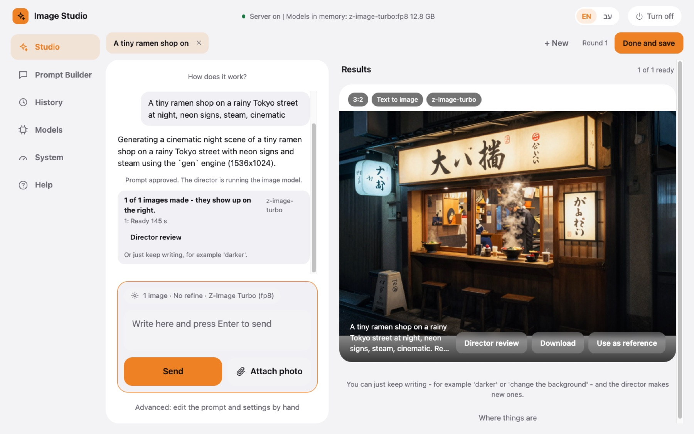
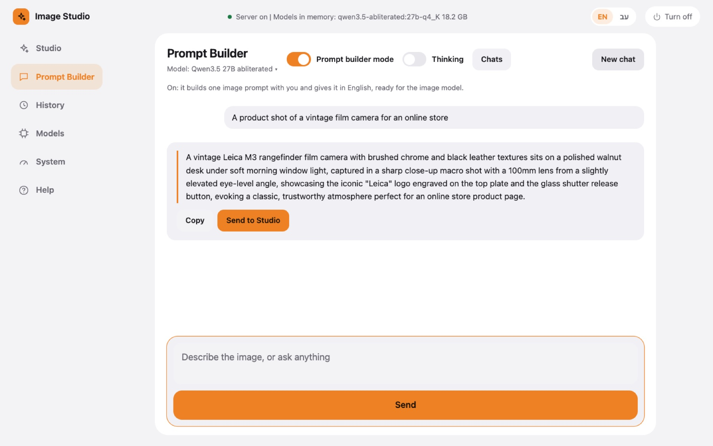
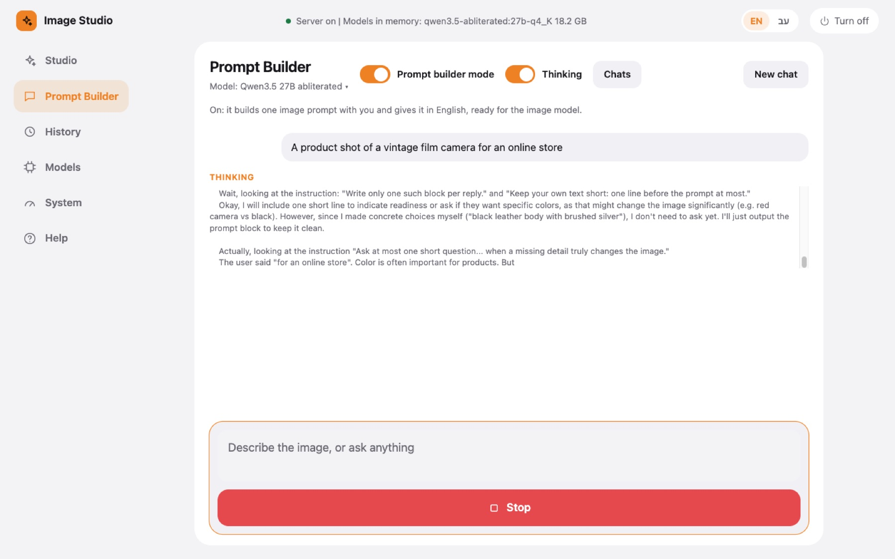
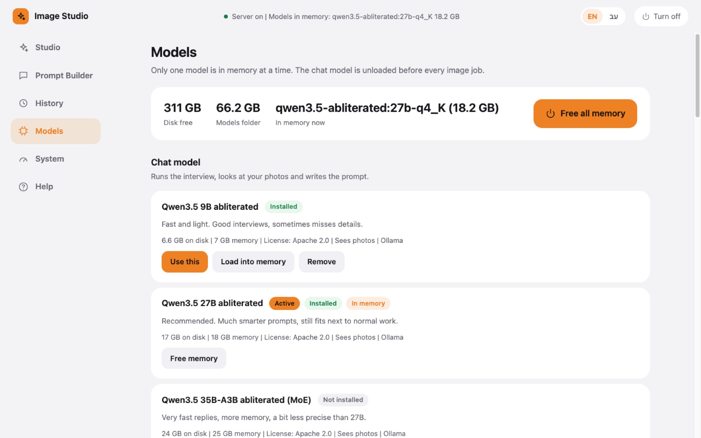
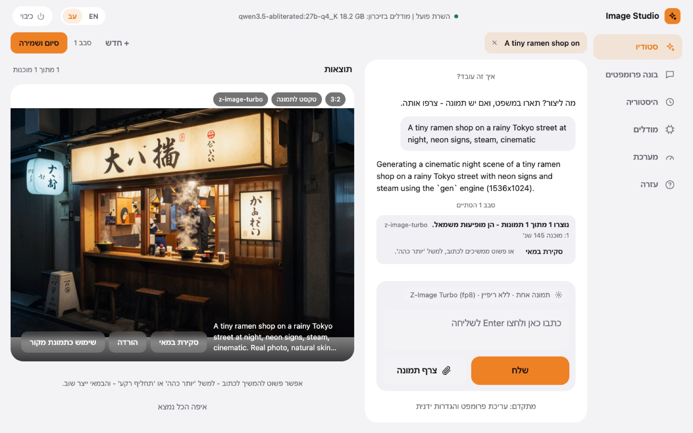

<div align="center">

# local-image-studio

**Your own AI image studio. On your Mac. Nothing leaves it.**

Talk to a local art director, approve the prompt, get the image.
No cloud, no account, no per-image cost, no upload of your photos.




</div>

## Why

- **Private by design.** Models, photos and results stay on your disk. The servers listen on
  `127.0.0.1` only.
- **A director, not a text box.** A local language model asks what matters, writes the prompt,
  runs the image model, looks at the result and leads the next round.
- **Edit with your own photos.** Change clothes, swap a background, put a person in a new scene.
  A face match score (ArcFace) checks that the person still looks like the person.
- **Zero cost when idle.** `img-on` starts it, `img-off` frees all of its memory. Only one model
  is in memory at a time, so it fits next to normal work on a 32-48 GB Mac.

> Small insight from building it: the image model is not the hard part. The prompt is.
> A local model that interviews you for 10 seconds beats a long prompt you write yourself.

## A look inside

| Prompt Builder: one ready prompt, then **Send to Studio** | Live thinking: see how the model reasons |
| --- | --- |
|  |  |
| **Models**: install, switch and free memory with one click | **Full Hebrew UI** with right-to-left layout |
|  |  |

More results (text in images, clothes edit, face swap, iterations): [docs/examples.md](docs/examples.md).

If this is useful to you, a star helps other people find it.

## Quick start

First time? See [Install on a new machine](#install-on-a-new-machine). Then:

```bash
img-on      # start server + portal, the portal opens in the browser
img-off     # stop everything: no process, no memory used (tabs and history are kept)
```

In the portal: **Studio** -> describe what you want (attach photos if any) -> the director writes
the prompt and generates at once -> say what to change, or press **Director review** for its opinion
-> **Done and save**.

Photos: **Attach photo** -> **Upload from this computer** or **From the library**, drag them onto the
page, or paste a screenshot into the text box. JPG, PNG and WEBP are kept as they are; HEIC (iPhone),
TIFF, GIF, BMP and AVIF are saved as JPEG so the models can read them. Max 40 MB per photo.

| Command | What it does |
| --- | --- |
| `img-on` | Start the private Ollama server and the portal, open the portal |
| `img-off` | Stop server, portal, every model; open the offline page |
| `img-status` | What runs and what is in memory |
| `img-portal` | Open the portal again (new link) |
| `img-home` | Offline start page (`portal/launcher.html`), bookmark it |
| `img` | Status and where things are, then the terminal director chat |
| `img-chat` | Terminal director chat only |
| `img-gen` / `img-edit` | Run a job by hand (see `docs/face-best-practice.md`) |
| `img-out` | Open the `outputs/` folder |

## Portal

- **Studio**: one tab per session, each with its own chat, photos, options and results.
  Memory per tab: `run/tabs/tab-mem-<n>.md` (rewritten after every change and iteration).
  **Done** moves the session to `outputs/sessions/<date>-<topic>/` (memory, prompt, images).
- **Prompt Builder**: a text-only chat, no images. The **Prompt builder mode** switch (on by
  default): on = it builds one English image prompt with you (role in `prompts/prompt-builder.md`)
  and shows it with **Copy** and **Send to Studio**; off = a plain language model, no system
  message and no options. Also a **Thinking** switch (show its thinking live), a model picker and
  a **Chats** list to reopen saved chats. Switches and model are kept in the browser. Chats are
  saved in History.
- **History**: every job (prompt, settings, models, images, notes) and every chat. Search, use again.
- **Models**: choose the active model per role, install / remove with progress, load / free memory.
- **System**: status, memory, paths, Free all memory, Turn off.
- **Help**: Examples first (use cases with real results - new image, text in image, clothes edit,
  new scene, face swap, iterations, settings, prompt builder; `docs/examples.md`, images in
  `docs/examples/`), then Quick start, where everything is (the repo tree) and all guides.

Language: English by default, Hebrew with the **EN | עב** switch in the top bar. All UI text lives in
`portal/i18n/en.json` and `he.json`; run `python3 scripts/check-i18n.py` after any UI text change
(it fails on missing, unused or untranslated strings).

If the portal stops, the open page switches to a text page that says what to run, and it
comes back by itself after `img-on`.

## Models (switch on the Models screen, see `docs/models.md`)

| Role | Active | Engine | Memory |
| --- | --- | --- | --- |
| Director (chat, sees images) | `huihui_ai/qwen3.5-abliterated:27b-q4_K` | Ollama 0.32.5, private, port 11535 | 18 GB |
| Text to image | `x/z-image-turbo:fp8` | Ollama 0.32.5 | 14 GB |
| Edit with photos | FLUX.2 klein 4B, 8-bit | mflux (Apple MLX) | 6 GB |

**Only one model is in memory at a time.** The chat model is unloaded before any image job.
The image model leaves memory 2 minutes after a job, the chat model 10 minutes after the last
message. An edit job loads its model once for all variations and exits. A warning shows when
free memory is low (for example when Ollama.app holds big models).

Identity quality gate: when a photo has a face, every result gets a face match score (ArcFace,
`bin/face_score.py`). New scenes get an automatic face pass. Below `QUALITY_MIN` (0.90) the studio
makes up to `QUALITY_RETRIES` (2) more rounds. Both live in `config/studio.env`.

The FLUX.2 klein 9B edit models need a Hugging Face login, so they are parked under `_disabled`
in `config/models.json`. Move an entry back into `models` to offer it again.

Ollama turned off image generation in 0.32.6+ (ollama/ollama#17893), so this project pins the
official 0.32.5 build in `vendor/` (SHA-256 checked). Ollama.app keeps its own version.

## Isolation and security

- Server and portal listen on `127.0.0.1` only (11535, 11536). Ollama.app (11434) is untouched.
- Portal: new random token on every start, HttpOnly cookie, a header token on every API call,
  Host check, no path traversal, uploads limited to images in `refs/`.
- Models in `models/`, photos in `refs/`, results in `outputs/`, history in `data/studio.db`,
  tabs in `run/tabs/`. All git-ignored and private (`chmod 700/600`). No secrets in the repo.
- The Hugging Face token (only for gated models) lives in `models/hf/token`.

## Layout

```
bin/studio            on / off / status / gen / edit / chat / portal
bin/portal.py         web portal server (stdlib)
bin/models.py         model catalog actions (install, activate, load, free, remove)
bin/store.py          history database + config edits
bin/tabs.py           Studio tabs and their memory files
bin/edit_batch.py     edit runner: one model load, many variations
bin/face_score.py     face match score (ArcFace) for the identity quality gate
bin/chat.py           terminal director chat
bin/studiolib.py      shared helpers
portal/index.html     the portal UI
portal/i18n/          UI text, en.json and he.json
portal/launcher.html  offline start page
config/studio.env     ports, active models, memory settings
config/models.json    the model catalog shown on the Models screen
prompts/interviewer.md  the director's instructions (shared by portal, terminal, Claude skill)
prompts/prompt-builder.md  the Prompt Builder role
shell/aliases.zsh     the img-* aliases (sourced from ~/.zshrc)
docs/                 models guide, face best practice, examples (EN and HE), screenshots
scripts/              install.sh, setup-ollama.sh, setup-edit.sh, check-i18n.py
pyproject.toml, uv.lock  Python packages (mflux, face score), pinned
.claude/skills/image-prompt  the same interview inside Claude Code
models/ outputs/ refs/ run/ logs/  private, git-ignored (only .gitkeep in git)
```

## Install on a new machine

Needs a Mac with Apple Silicon (32 GB+ memory recommended), about 60 GB free disk, and
`curl jq git uv` (`brew install jq uv`).

```bash
git clone https://github.com/danielmazh/local-image-studio.git
cd local-image-studio
scripts/install.sh           # venv, pinned Ollama, models (~50 GB), img-* aliases; safe to re-run
scripts/install.sh --check   # only report what is missing
```

Open a new terminal, then `img-on`. Options: `--no-models`, `--no-edit`, `--no-shell`.
The clone can live in any folder.

## Uninstall

`img-off`, remove the line that sources `shell/aliases.zsh` from `~/.zshrc`, delete this folder.

## Notes

- Pillow is pinned below 13: Pillow 13 fails to import on Homebrew Python 3.13.

## Third-party software and models

This repo ships no model weights and no third-party binaries. The installer downloads them, and
each one keeps its own license. Check the model card before any commercial use.

| Component | License |
| --- | --- |
| Ollama 0.32.5 | MIT |
| mflux | MIT |
| Z-Image Turbo (`x/z-image-turbo`) | Apache 2.0 |
| FLUX.2 klein 4B (edit) | Apache 2.0 |
| FLUX.2 klein 9B (`x/flux2-klein:9b`) | FLUX Non-Commercial License |
| Qwen3.5 abliterated (huihui_ai) | see the model card (base: Qwen license) |
| InsightFace code / `buffalo_l` face model | MIT / non-commercial research only |

## Responsible use

This tool can change faces and make realistic images of people. Use photos only of people who
agreed. Do not make images that deceive, harass, sexualize real people or break the law where you
live. You are responsible for what you make with it.

## License

MIT, see [LICENSE](LICENSE). Copyright (c) 2026 danielmazh.
